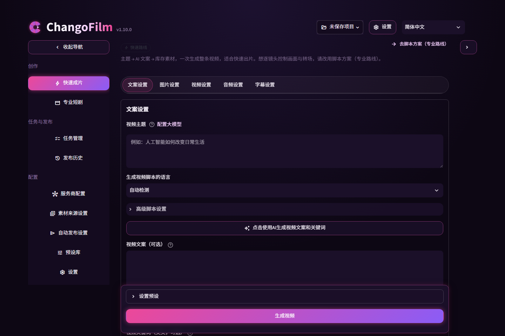
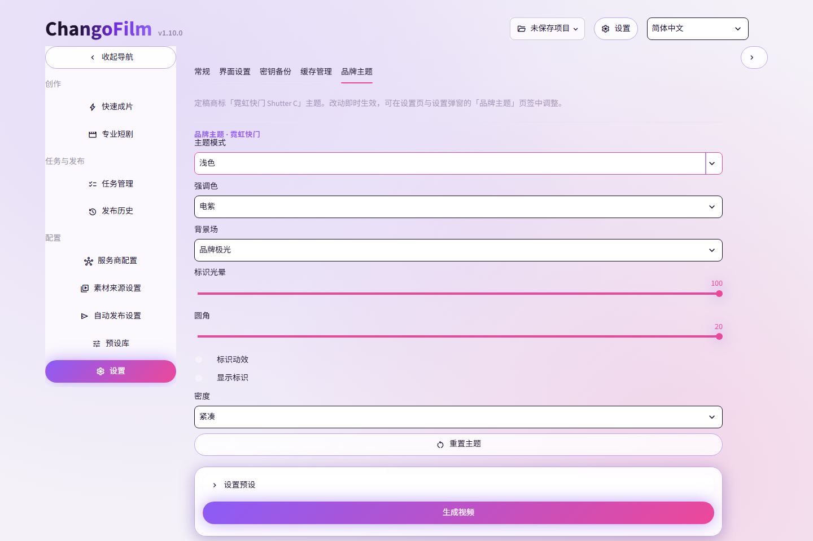
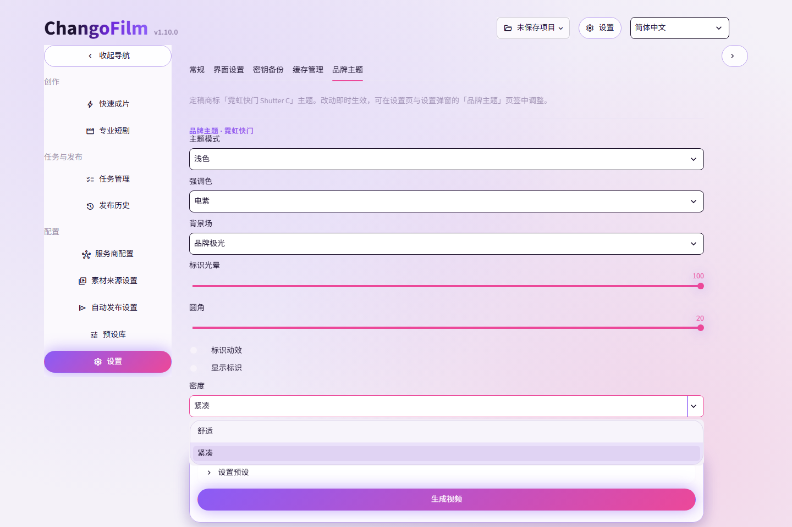

# 2026-11-22 迭代记录（v1.11.0）：侧边栏精简、浅色主题与主题设置迁移

本轮迭代为功能驱动型，来自用户三条 UI 诉求：**优化左侧菜单（去除多余 LOGO）、
新增浅色主题、把首页左导航底部的常驻主题设置面板移入设置菜单 TAB 页**。三条诉求
互相咬合：左导航撤掉品牌 lockup 与常驻主题面板后，主题入口必须有新家——设置页
新增第五个「品牌主题」TAB（与设置弹窗既有 brand TAB 双前缀并存）；同时主题系统
从"仅深色"升级为 dark/light 双模式。核心技术结论：**Streamlit 1.66 的 Emotion
样式把 `config.toml [theme]` 的暗色解析值直接硬编码进组件样式、不经过 `--st-*`
变量（实跑探针证实：变量已覆写但 computed color 不变），浅色模式单靠变量覆写
翻不动正文与控件底色**，必须以品牌变量显式 var 驱动的规则块逐点覆盖。

版本号按"每次迭代必升版"政策升版。**背景说明**：本迭代的任务计划文件按旧基线
写作 `v1.9.0`，但实际版本基线在计划执行时已推进到 `1.10.0`（同日早前已发布僵尸
探测器迭代），故按"逐次递增、不再停留旧基线"政策落为 **`1.11.0`**（minor：新增
面向用户的浅色主题与主题设置迁移）。实现期产物（截图 `v190-*.png`、门禁输出
`pytest-full-v190.txt`、`test_brand_theme.py` 模块注释）保留了计划基线的 `v190`
命名，属历史痕迹，不影响版本递增事实。

> **提交批次现状（version-release 需知）**：本轮变更中 `webui/Main.py`（侧边栏
> 精简 + 设置页第五 TAB）与 `webui/i18n/*.json`（主题三键 + Hint 改写）两部分
> **已随 0401f69（feat(publish) 僵尸探测器批次）先行入库**——`git log -S cfpage`
> 唯一命中 0401f69、`git diff HEAD -- webui/Main.py` 为空、0401f69 的 i18n diff
> 含 Theme Mode 三键（三重实证）。其余变更（`brand_theme.py`、`brand.css`、新增
> 测试、`verify-theme.mjs` 重做、截图、升版产物）仍未提交，待 `version-release`
> 以 `release: v1.11.0` 批次入库（可按仓库惯例拆 feat(webui) + release 两批）。

---

## 1. 任务目标

| # | 诉求 | 现状问题 | 方案与结果 |
|---|------|----------|-----------|
| 1 | 优化左侧菜单，去除多余 LOGO | 左导航顶部渲染品牌 lockup（`brand_theme.render_nav_brand`），与顶栏 `_render_brand` 品牌行完全重复；导航底部还挂着常驻主题面板，挤占导航空间 | 删除左导航品牌区与常驻面板：品牌只在顶栏出现一次；侧边栏只剩收起按钮 + 页面导航 + 任务徽章 + 快捷入口 |
| 2 | 主题设置移入设置菜单 TAB | 常驻面板撤场后主题入口无处安放 | 设置页新增第五个「品牌主题」TAB（`cfpage` 前缀，守卫 `brand_tab.open` 惰性渲染）；设置弹窗既有 brand TAB（`cfset` 前缀）保留，双前缀无键冲突 |
| 3 | 新增浅色主题 | 主题系统仅深色；Streamlit 1.66 Emotion 把 config.toml 暗色值硬编码进样式 | 会话级 `mode` 字段 + 双调色板分支；浅色额外覆写 Streamlit 基础变量并新增约 30 条 var 驱动规则覆盖硬编码位置；深色逐像素等价零回归 |

**浅色模式的难点（本轮关键技术突破）**：`variables_css()` 早已覆写 `--st-*`
变量，但浅色下正文与输入面依旧暗色——实跑探针（`.tmp-ui-impl/probe-st-vars*.mjs`）
证实 Streamlit 1.66 Emotion 在构建期把 `config.toml [theme]` 的暗色解析值**直接
写进组件样式**而非引用变量。结论：变量覆写只能翻转"走变量"的规则；对 Emotion
硬编码位置必须在 brand.css 以 `var(--cf-*)` 显式锚定并 `!important` 覆盖。
深色模式下这些变量的取值与 config.toml 现值**逐像素等价**（`color-mix` 推导，
如滑杆刻度条 = 60% ink），故新增规则块在深色下零视觉变化。

## 2. 变更清单

### 2.1 侧边栏精简（对应已入库批次 0401f69 的 Main.py 部分 + 未提交的 brand 文件）

- `webui/Main.py`（**已随 0401f69 入库**）：`_render_nav_sidebar()` 删除
  `brand_theme.render_nav_brand(collapsed)` 品牌渲染（与顶栏 `_render_brand`
  重复）；删除底部 `brand_theme.render_controls("cfnav", tr)` 常驻主题面板整块。
  现函数仅含：收起/展开切换按钮、`NAV_PAGES` 分组导航按钮（任务页走
  `_render_nav_tasks_entry`）、`_render_shell_shortcuts()` 快捷入口。
- `webui/brand_theme.py`（**未提交**）：删除 `lockup_svg()`（340×100 渐变文字
  lockup）与 `render_nav_brand()`（渲染 `.cf-nav-mark`/`.cf-nav-lockup`）——
  唯一调用点已随 Main.py 撤场；`_mark_inner()`/`mark_svg()` 保留供顶栏使用；
  `_reset()` 复位前缀元组 `("cfnav","cfset")` → `("cfset","cfpage")`，旧
  `cfnav_*` 会话键随左导航撤场废弃（测试断言无残留）。
- `webui/brand.css`（**未提交**）：删除 `.cf-nav-lockup`/`.cf-nav-mark` 全部
  规则块（含 `cfGlow` 光晕动画选择器列表中的 `.cf-nav-lockup svg`，现仅
  `.cf-mark, .changofilm-brand__mark svg`）；文件头变量清单同步更新。

### 2.2 主题设置迁入设置页 TAB（Main.py 部分**已随 0401f69 入库**）

- `_render_settings_page()` 的键控 `st.tabs` 新增第五个页签「品牌主题」
  （`tr("Brand Theme Tab")`，i18n 键沿用弹窗既有键）；`brand_tab.open` 守卫下
  渲染 `st.caption(tr("Theme Dialog Hint"))` + `brand_theme.render_controls("cfpage", tr)`
  ——TAB 未选中不渲染控件，惰性加载语义与其它 TAB 一致。
- 设置弹窗 brand TAB 保留不动：`tab_keys["brand"]` + `brand_panel.open` 守卫 →
  caption + `render_controls("cfset", tr)`。两处控制区前缀不同（`cfpage_*` /
  `cfset_*`），控件键零冲突；会话主题 `cf_theme` 是唯一事实源，任一处改动即时
  生效且另一处渲染前经 `_sync` 对齐。
- `render_controls` 控件清单由 8 项增至 9 项：新增主题模式下拉后为
  4 selectbox（模式/强调色/背景场/密度）+ 2 slider（标识光晕/圆角）+
  2 toggle（标识动效/显示标识）+ 重置按钮（verify-theme 断言 4/2/2+reset）。

### 2.3 新增浅色模式（`webui/brand_theme.py` + `webui/brand.css`，**未提交**）

- **会话主题扩展**：`DEFAULTS` 新增 `"mode": "dark"`（默认深色）；`MODES =
  {"dark": "Theme Mode Dark", "light": "Theme Mode Light"}` 下拉；
  `_FIELDS` 首位插入 `"mode"`（同步/复位/对齐三处遍历自动覆盖新字段）；
  `theme()` 对非法 `mode` 回退 `DEFAULTS["mode"]`（与 accent/field/density
  同一防御风格）。
- **双调色板**：深色内联值重构为 `_DARK_PALETTE`（数值逐项不变）+ 新增
  `_LIGHT_PALETTE`：`--cf-bg #F4F1F8` / `bg2 #FBF9FD` / `surface #FFFFFF` /
  `surface2 #F7F4FB` / `line #DCD2EA` / `line-soft #E9E2F4` / `ink #1D1330` /
  `muted #6F5C88`——浅色保持品牌紫罗兰底味，等价替换暗色五组表面变量。
  阴影三变量按模式给出：深色硬阴影不变（strong `0 24px 64px rgba(0,0,0,.55)` /
  bar `.45` / row `.4`），浅色软化版（`rgba(29,19,48,.22)` / `.16` / `.14`），
  避免黑阴影压在浅底上。
- **强调色语义**：浅色下链接/悬停/选中文字（`--cf-link`、`--cf-accent-pale`）
  与播放三角（`--cf-mark-tri`）改用当前强调色 **deep** 端（电紫强调 `#6D28D9`、
  默认 magenta 强调 `#C026D3`），浅粉在白底不可读；深色沿用浅粉（`#F5D0FE`）。
  `:root` 写入 `color-scheme:dark|light`。
- **Streamlit 基础变量双写**：浅色额外覆写 `--st-text-color` / `--st-background-color` /
  `--st-secondary-background-color` 并同写旧无前缀名（`--text-color` 等），
  否则未走 `--cf-*` 的通用文字/输入面仍继承暗色主题浅色字；深色不写
  （服务端 `[theme]` 已是暗色，测试断言深色 CSS 中无 `--st-text-color`）。
- **brand.css 硬编码覆盖块**：新增「Streamlit 硬编码底色/文字跟随明暗模式」
  规则块（约 30 条），逐点覆盖 Emotion 硬编码位置：`body`/`stApp` 底色文字、
  `stAppViewContainer`/`stMain`/`stMainBlockContainer` 文字、react-aria selectbox
  触发器（`stSelectbox` 内 `div[role=group]` + `input[role=combobox]` + svg）、
  `stTextAreaRootElement`、`stSelectboxVirtualDropdown` 浮层菜单与选项、
  `stBaseButton-secondary/tertiary` 文字、`stPopover` 触发钮、`stTab` 页签文字、
  `stWidgetLabel` 标签、`stCheckbox`、`stSliderTickBar`（60% ink）、
  `stFileUploaderDropzone` 上传区与提示（60% ink）。
- **播放三角换色规则**：brand.css 新增
  `.cf-mark path:last-of-type { fill: var(--cf-mark-tri, #F5D0FE) }`（CSS 规则
  优先于 SVG 表现属性 fill），保证浅色下顶栏播放三角可见。
- **背景场浅色分支**：`_field_bg()` 增加 `mode` 参数——浅色下 `black` 场回退
  `bg2`，`aurora`/`deep` 场以强调色低透明径向渐变叠加浅底，避免深色场照搬。
- **重阴影去硬编码**：brand.css 3 处硬编码盒阴影改走变量——设置弹窗
  （`stDialog > div`）→ `--cf-shadow-strong`、预设栏 → `--cf-shadow-bar`、
  预设行 hover → `--cf-shadow-row`。
- **明确非目标**：主题仍为会话级、不持久化（重启回默认）；默认模式 dark。

### 2.4 i18n（`webui/i18n/*.json` ×14，**已随 0401f69 入库**）

- 14 个语言文件（zh/en/az/ca/de/es/fr/id/it/ko/pt/ru/tr/vi）各新增 3 键：
  `Theme Mode` / `Theme Mode Dark` / `Theme Mode Light`（本次文档生成时逐文件
  Grep 复核 14/14 齐全；`test_theme_mode_keys_exist_in_every_locale` 参数化
  ×14 实测全绿）。
- `Theme Dialog Hint` 文案改写（去除"与左导航主题面板保持同步"表述）：zh 为
  「定稿商标「霓虹快门 Shutter C」主题。改动即时生效，可在设置页与设置弹窗的
  「品牌主题」页签中调整。」，en 同步。

### 2.5 视觉验证脚本与截图证据（**未提交**）

- `docs/changofilm-logo/verify-theme.mjs` 全面重做（267 行变更：+181/−86）：
  改经设置页第五 TAB 的 `cfpage_*` 控件驱动主题（不再依赖已撤场的左导航面板），
  设置弹窗 `cfset_*` 仍探针共享会话主题；断言 `.cf-nav-lockup` 不存在、
  `st-key-cfnav_*` 面板离场；新增浅色断言组（`--cf-bg` 翻转 `#F4F1F8`、
  `color-scheme: light`、app 容器 computed background `244,241,248`、正文
  computed color `29,19,48`、阴影变量软化、mark-tri 换色）；运行环境
  `http://127.0.0.1:8511`，末尾 `ALL CHECKS PASSED` / exit 0（无 console 错误）。
- 10 张截图证据 `docs/changofilm-logo/shots/v190-*.png`：`01-dark-home` /
  `02-dark-settings-brand` / `03-dark-violet-aurora` / `04-dark-compact-nologo` /
  `05-light-violet-aurora` / `05a-light-top` / `05b-light-menu-open` /
  `06-light-deep` / `07-dialog-brand` / `08-mobile`。深色与现状零回归，浅色
  全局可读（下拉菜单、输入框、弹窗、上传区均 var 驱动）。关键三张：

> 截图捕获时升版尚未执行，顶栏应用内版本角标显示 `v1.10.0`（截图时点的运行
> 版本），与主题工作无关；升版后角标随 `config.project_version` 自动跟随。

### 2.6 版本号升级（升版产物**未提交**，随 `release: v1.11.0` 批次入库）

- 升版结果：**`v1.10.0 → v1.11.0`**；bump 级别 **minor**——新增面向用户的
  浅色主题与主题设置迁移（UI 新功能，非修复）。
- 同步修改的文件（对齐 `release: v1.10.0`（4158c5d）批次先例，本次升版为用户
  手工完成、本文档生成时逐处复核）：
  1. `app/__init__.py`：`__version__ = "1.11.0"`；
  2. `pyproject.toml`：`version = "1.11.0"`（与 1 一致，已复读校验）；
  3. `uv.lock`：`changofilm` 自条目 `version = "1.11.0"`；
  4. `app/services/codex_oauth.py`：硬编码 User-Agent `ChangoFilm/1.11.0` ×2；
  5. `docs/packaging.md`：当前待发布版本 + wheel/sdist 文件名示例 ×4；
  6. `README.md` / `README-en.md` / `README-ja.md`：版本徽章 ×3（仅版本号
     同步，不改章节结构、不记录本地迭代）；
  7. `docs/ui-redesign-demo/index.html`：品牌徽章 `v1.11.0 · UI Demo`。
- 历史快照不改：`docs/迭代记录文档/v1.10.0_*.md` 及更早记录、
  `docs/release-notes-v*.md` 保留原样。升版后 `git grep "1.10.0"` 复核：业务
  代码与文档**零残留**，唯一命中为历史迭代记录文档 `v1.10.0_2026-11-22_*.md`
  （历史快照，按惯例不改）。

### 2.7 本地变更（不入库）

- `.tmp-ui-impl/`（gitignore）：门禁输出 `pytest-full-v190.txt`、基线失败集
  `pytest-baseline-rebrandnorm.txt`、门禁对比脚本 `diff_failures.py`、
  Streamlit 变量探针 `probe-st-vars*.mjs` 等——全部为本次迭代的实证过程产物，
  不入仓库。
- 本轮无 `config.toml` 本地配置变更（主题走会话级 `st.session_state["cf_theme"]`，
  不落配置文件）。

## 3. 验证汇总

- ✅ **新增 `test/services/test_brand_theme.py`：25 passed**（本次文档生成时
  实测重跑；12 个测试函数，locale 键存在性 ×14 参数化）。覆盖：
  `theme()` mode 校验回退、深色默认断言（`color-scheme:dark`、`--cf-mark-tri:
  #F5D0FE`、无 `--st-text-color`）、浅色调色板断言（含 `--cf-mark-tri` 换色、
  `color-scheme`、Streamlit 基础变量双写覆写）、浅色背景场浅底分支、源码级
  守卫（Main.py 无 `render_nav_brand`/`cfnav` 挂载）、mode 字段控件键同步与
  双前缀复位、14 locale 三键齐全、AppTest 契约：默认页不挂主题控件、设置页
  含 `cfpage_mode`、弹窗保留 `cfset_*` 控件、模式选择同步会话主题、复位两处
  控制区回默认。
- ✅ **triage 子集回归：85 passed / 18913 subtests**（本次文档生成时实测重跑）：
  `.venv\Scripts\python.exe -X utf8 -m pytest test/services/test_brand_theme.py
  test/services/test_settings_navigation.py test/services/test_webui_i18n.py -q`
  → 85 passed（brand theme 25 + settings navigation 43 + webui i18n 17）+
  18913 subtests，零失败。
- ✅ **全量门禁**（`.venv\Scripts\python.exe -X utf8 -m pytest test -q`，输出
  存于 `.tmp-ui-impl/pytest-full-v190.txt`）：**3681 passed / 23 failed /
  152 skipped / 19629 subtests passed in 23:10**。
- ✅ **回归对比（`diff_failures.py`，基线 `pytest-baseline-rebrandnorm.txt` vs
  本次 `pytest-full-v190.txt`；本次文档生成时实测重跑）**：基线失败集 66 →
  改后失败集 23，**NEW=1**——唯一 NEW 为
  `test/services/test_version_checker.py::TestProjectVersionMetadata::test_runtime_version_matches_pyproject`，
  系升版在门禁运行中执行导致进程内 `__version__`（旧）与 pyproject（新）不一致
  的**陈旧产物**；门禁后单独重跑 **1 passed** 已证伪，非真实回归。其余 22 失败
  全部 ∈ 基线 66 失败集合（Windows 符号链接权限 WinError 1314、loopback、
  launcher `.bat` 参数化等环境类）。**有效 NEW=0**；另 fixed 44（基线环境类
  失败在本次环境自然通过）。
- ✅ **视觉验证**：`node docs/changofilm-logo/verify-theme.mjs` headless
  Playwright 实跑 **ALL CHECKS PASSED**（exit 0，无 console/page errors），
  10 张截图留证（见 §2.5）；本次文档生成时人工复核关键截图：深色首页侧边栏
  无 LOGO 无常驻面板、浅色下设置页第五页签/主题面板/下拉浮层全局可读。
- ✅ **升版一致性**：`app/__init__.py` 与 `pyproject.toml` 均为 `1.11.0`
  （复读校验）；`uv.lock` 自条目、User-Agent ×2、packaging ×4、README 徽章
  ×3、UI demo 徽章逐处 Grep 核实。

## 4. 交付物清单

### 新增文件（未提交）
1. `test/services/test_brand_theme.py` —— 主题模式/CSS 输出/设置宿主契约
   12 函数（×14 locale 参数化后 25 例）。
2. `docs/changofilm-logo/shots/v190-*.png` ×10 —— 深浅两模式视觉证据
   （另有探针期截图 `probe-dialog-after-pick.png` 一并留证）。
3. `docs/迭代记录文档/v1.11.0_2026-11-22_侧边栏精简浅色主题与主题设置迁移.md`
   —— 本文档。

### 修改文件
1. `webui/brand_theme.py`（未提交）—— mode 字段/双调色板/`--cf-mark-tri`/
   阴影三变量/浅色 `_field_bg`/`_reset` 双前缀/删除 `lockup_svg` 与
   `render_nav_brand`。
2. `webui/brand.css`（未提交）—— 删 `.cf-nav-lockup`/`.cf-nav-mark` 规则块、
   收窄光晕动画选择器、新增 mark-tri 规则、3 处阴影走变量、约 30 条
   Streamlit 硬编码覆盖块。
3. `webui/Main.py` —— 侧边栏精简 + 设置页第五「品牌主题」TAB
   （**已随 0401f69 入库**，无未提交残留）。
4. `webui/i18n/*.json` ×14 —— Theme Mode 三键 + Theme Dialog Hint 改写
   （**已随 0401f69 入库**，无未提交残留）。
5. `docs/changofilm-logo/verify-theme.mjs`（未提交）—— 视觉验证脚本按
   cfpage 驱动全面重做 + 浅色断言组。
6. `app/__init__.py` / `pyproject.toml` / `uv.lock` / `app/services/codex_oauth.py`
   / `docs/packaging.md` / `README.md` / `README-en.md` / `README-ja.md` /
   `docs/ui-redesign-demo/index.html`（均未提交）—— v1.10.0 → v1.11.0 升版
   产物（见 §2.6）。

> 工作区另有与本主题无关的未提交改动，**不属于本次迭代**、不纳入 release
> 批次：`resource/fonts/MicrosoftYaHeiBold.ttc`、`resource/public/index.html`、
> `docs/ui-demo/auto-publish-cn.html` 与 `docs/ui-demo/auto-publish-cv-v2*`
> （ChangoVideo 发布演示素材）、`.qoder/plans/`（既有计划文档）。

## 5. 遗留与边界

- **未提交批次**：`brand_theme.py`、`brand.css`、`test_brand_theme.py`、
  `verify-theme.mjs`、截图 ×10 + 探针截图、升版产物 ×9 文件与本文档，待
  `version-release` 提交（建议拆 `feat(webui)` + `release: v1.11.0` 两批；
  Main.py 与 i18n 部分已随 0401f69 在库，无需重复提交）。本 agent 不做 Git
  提交。
- **提交历史口径**：0401f69 的提交信息只描述僵尸探测器，未提及同批带入的
  侧边栏/主题迁移 Main.py 与 i18n 变更；本文档即该部分变更的正式变更记录，
  后续 release 批次信息引用本文档即可，无需改写历史提交。
- **主题仍会话级不持久化**：重启 WebUI 回默认深色；`config.toml` 不落主题
  键。若后续需要持久化，应在 `app/config.py` 增加用户设置项并接 `_sync`，
  属独立迭代。
- **默认 dark、浅色为新增模式**：未改动任何服务端 `[theme]` 配置；深色路径
  逐像素等价（`color-mix` 推导与现值一致），深色用户零感知。
- **Emotion 硬编码覆盖为白名单式**：约 30 条规则覆盖实测到的硬编码位置；
  升级 Streamlit 版本若引入新的硬编码位置，需按探针法（probe-st-vars*.mjs）
  重新盘点补规则——已记入 verify-theme.mjs 注释。
- **实现期产物命名保留 v190 前缀**（截图/门禁输出/测试模块注释），源于任务
  计划的旧基线版本号；版本递增事实以本文档与两处版本字段为准。
- **门禁输出在 gitignore 目录**（`.tmp-ui-impl/`），换机不随仓库迁移；结论
  已固化到本文档 §3。
